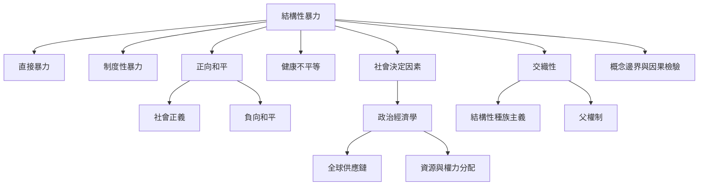

結構性暴力可視為連接直接傷害、社會制度、歷史權力與生命機會的中層分析概念。這張圖由核心定義出發，向外連結暴力類型、和平概念、制度與權力、健康結果及分析方法。閱讀時應留意：概念彼此重疊，但不應被當作同義詞。

## 思與行
* 從[[結構性暴力]]開始，再依研究問題選擇直接暴力、制度性暴力或健康公平等鄰近概念。
* 進行案例分析時，不要把圖上的每個節點都當成必要原因；只保留有證據支持的關係。

## 參考
* [[結構性暴力是被制度化的生命機會剝奪]]。
* [[直接暴力與結構性暴力可以在同一事件中交織]]。
* [[結構性暴力需要可檢驗的因果鏈而非只靠道德標籤]]。
* 概念定義：[[結構性暴力]]、[[直接暴力]]、[[正向和平]]、[[負向和平]]、[[制度性暴力]]。
