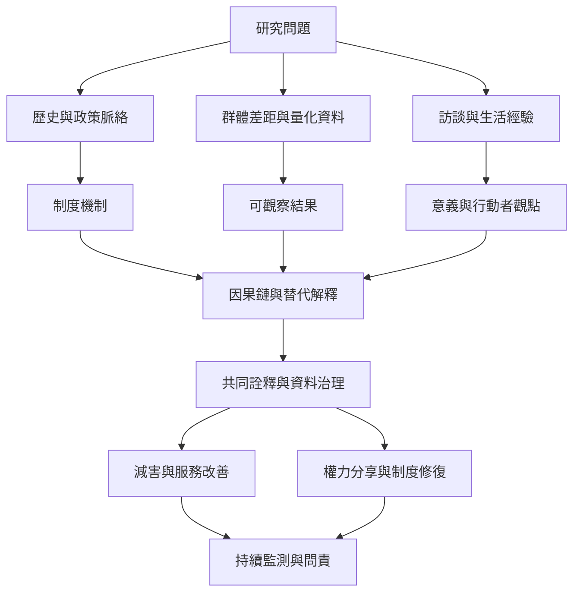

結構性暴力研究需要同時處理因果證據、受影響者經驗、制度問責和改變策略。研究方法不是單一工具，而是將統計、歷史、民族誌、政策分析與參與式研究組合；行動則同時包含立即減害與改變長期權力配置。

## 思與行
* 以[[結構性暴力需要可檢驗的因果鏈而非只靠道德標籤]]作為研究品質檢核。
* 以[[把受影響社群納入研究設計而不只邀請他們作為受訪者]]和[[把政策評估從服務數量延伸到決策權與補救能力]]作為行動轉化方向。

## 參考
* [[和平研究對結構性暴力的批評提醒研究者必須界定邊界]]。
* [[受壓迫者的能動性必須與結構限制一起被描述]]。
* 概念定義：[[社群參與式研究]]、[[健康公平]]、[[社會正義]]、[[環境正義]]。
