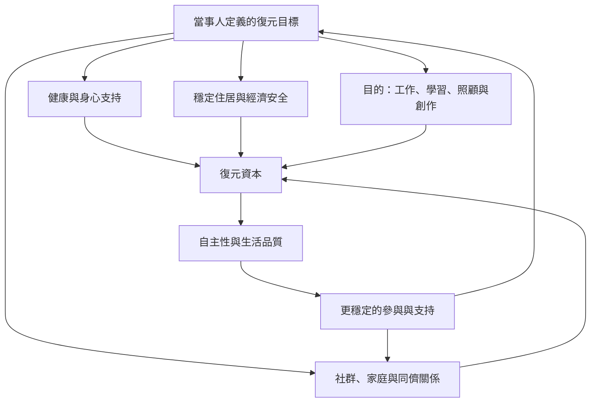

復元可以理解為生活系統逐步恢復選擇、連結與穩定的過程。醫療治療可能是重要的一環，但住房、收入、日常活動、社群歸屬與支持關係同樣會影響人能否維持自己選定的生活方向。

這張地圖避免把復元資本誤解成個人必須自行累積的分數；資源能否取得也取決於住房政策、福利、勞動市場、歧視與醫療服務。參見[[復元是由當事人定義的多路徑生活重建]]、[[社會支持與復元資本能擴大改變的實際可能]]、[[復發或中斷應被視為調整照護的訊號而非道德失敗]]。

## 參考

* 概念：[[Recovery|復元]]、[[Recovery_capital|復元資本]]、[[Peer_support|同儕支持]]、[[Social_determinants_of_health|健康的社會決定因素]]。
* 資料：[[紐西蘭鴉片類維持治療指引把自主文化安全與減害納入照護]]。
