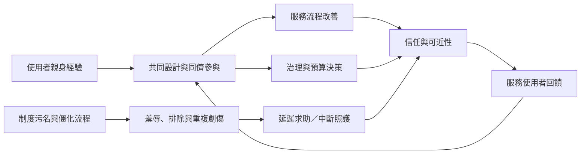

服務品質不只是治療技術是否有效，也包括使用者是否受到尊重、是否擁有選擇、是否能安全表達意見，以及他們是否有權共同決定服務如何運作。污名會降低信任；參與式治理則可能讓制度看見自身盲點。

真正的參與必須有資訊、資源、酬勞、決策權與退出權，不能只邀請當事人提供故事。參見[[參與式知識生產能修正專業制度的盲點]]、[[污名與僵化流程會使求助者在治療入口再次受傷]]、[[把當事人共治納入藥癮服務品質指標]]。

## 參考

* 概念：[[Stigma|污名]]、[[Trauma_informed_care|創傷知情照護]]、[[Peer_support|同儕支持]]。
* 資料：[[物質使用者的親身經驗應轉化為政策決策中的實質權力]]。
