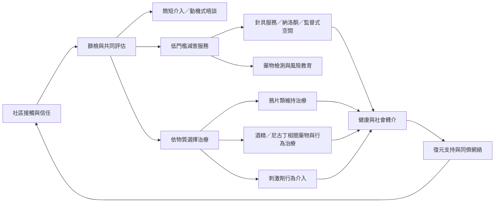

減害與治療不是互相排斥的兩條路，而是能依當事人需求組合的連續服務。不同物質需要不同的臨床選項；社區支持、同儕連結、過量預防與社會服務則可跨越多種物質類型。

此圖的核心是「不因尚未準備好戒除而失去照護」。當事人可以在不同節點進入或重新進入服務，目標也可以隨時間改變。參見[[減害把生命與尊嚴置於立即戒斷之前]]、[[以人為本的照護需要連續性而非單次轉介]]、[[不同物質需要不同介入而非同一套戒癮模板]]。

## 參考

* 概念：[[Harm_reduction|減害]]、[[Naloxone|納洛酮]]、[[Opioid_agonist_therapy|鴉片類促效劑維持治療]]、[[Motivational_interviewing|動機式晤談]]、[[Contingency_management|增強式管理]]、[[Peer_support|同儕支持]]。
* 資料：[[台灣減害政策以清潔針具維持治療與篩檢轉介構成連續照護]]、[[刺激劑使用疾患的現行指引優先採用行為介入與持續支持]]。
