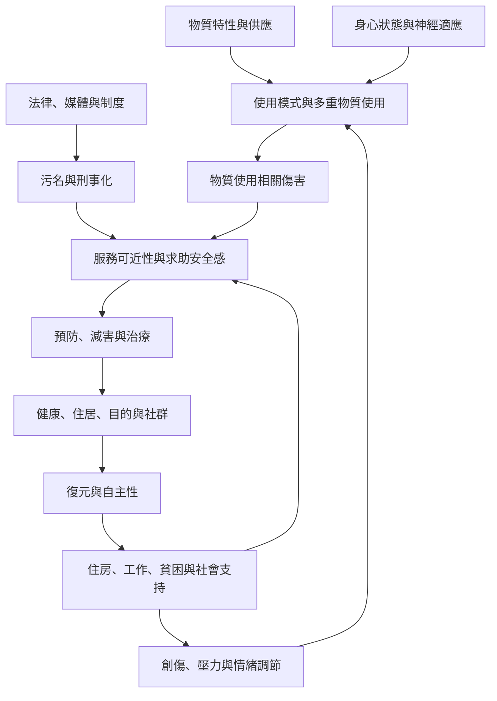

物質使用不是單一原因造成的線性問題，而是物質特性、個體狀態、關係網絡、社會條件與政策制度共同作用的系統。此圖把風險、疾患、污名、服務與復元連在一起，閱讀時要避免把任何一個節點當成唯一原因。

此系統觀點連結[[物質使用風險是物質個體與環境交互作用的結果]]、[[成癮理解需要整合腦神經心理社會與制度脈絡]]、[[污名與刑事化會製造次級傷害並阻礙照護]]、[[社會支持與復元資本能擴大改變的實際可能]]。

## 參考

* 概念：[[Substance_use|物質使用]]、[[Substance_use_disorder|物質使用疾患]]、[[Social_determinants_of_health|健康的社會決定因素]]、[[Trauma_informed_care|創傷知情照護]]、[[Stigma|污名]]。
* 資料：[[UNODC全球資料顯示物質使用型態與治療需求具有明顯區域差異]]。
