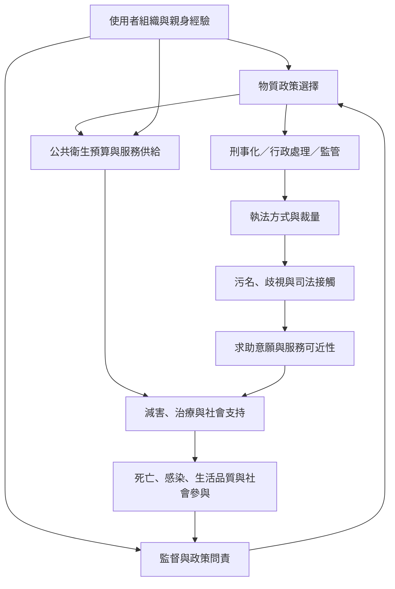

藥物政策不只決定哪些物質受到管制，也會影響誰能取得服務、誰遭到監控、誰有機會參與決策，以及公共資源如何分配。評估政策時要同時觀察健康、人權、司法與社會結果。

葡萄牙案例呈現除罪化與服務配套的關係；HRI 與 INPUD 的材料則提醒，政策參與若沒有使用者實質權力，仍可能保留原有權力不平等。參見[[葡萄牙除罪化的結果取決於健康服務配套而非單一法律改變]]、[[物質使用者的親身經驗應轉化為政策決策中的實質權力]]、[[物質政策應以可觀察的健康結果而不是道德姿態評估]]。

## 參考

* 概念：[[Decriminalization|除罪化]]、[[Stigma|污名]]、[[Harm_reduction|減害]]。
* 資料：[[全球減害服務逐步擴張但資金與地理覆蓋仍極不均]]。
