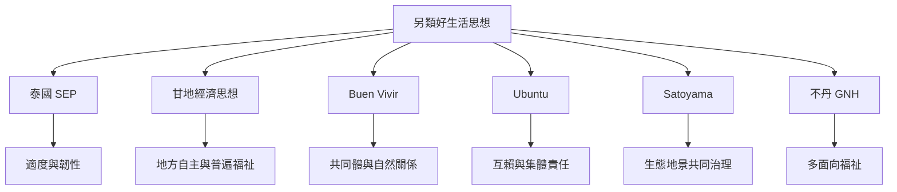

世界各地存在多種以好生活、地方自主、共同體及自然關係為核心的替代經濟思想。泰國 SEP、印度甘地思想、安地斯 Buen Vivir、非洲 Ubuntu、日本 Satoyama 與不丹 GNH 各有不同歷史脈絡。比較應以概念翻譯、實踐方式與權力關係為主，不應把它們合併為單一普世模式。

## Mermaid 關係圖

## 概念連結
[[term/泰國足夠經濟哲學]]、[[term/甘地經濟思想]]、[[term/Buen Vivir]]、[[term/Ubuntu]]、[[term/Satoyama]]、[[term/國民幸福總值]]、[[note/跨文化比較應移植原則而非複製制度]]。

## 延伸閱讀
[[data/泰國足夠經濟可與佛教伊斯蘭及甘地經濟思想比較]]、[[data/安地斯 Buen Vivir 將好生活與共同體及自然關係連結]]、[[data/Ubuntu 以互賴與集體福祉重新思考非洲發展]]、[[data/甘地經濟思想以 Swadeshi 與 Gram Swaraj 支持地方自主]]、[[data/日本里山倡議以社會生態生產地景整合傳統知識與科學]]。

全書：[[Sufficiency_economy]]。
