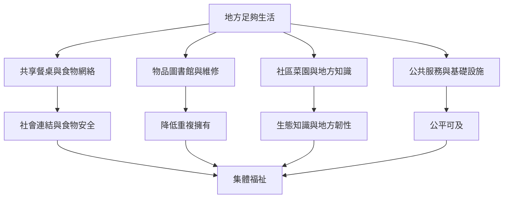

地方足夠經濟可由社區共享、食物系統、物品維修、地方知識、共同治理及公共服務組成。這些活動不是要地方完全自給，而是增加生活資源的可及性、替代選項與社群韌性。制度設計必須注意管理勞動、權利、衛生、安全、資金及參與平等。

## Mermaid 關係圖

## 概念連結
[[term/互賴]]、[[term/公地]]、[[term/團結經濟]]、[[term/地方化]]、[[term/韌性]]、[[idea/把共享餐桌設計成地方足夠經濟的微型實驗]]、[[idea/建立社區物品圖書館降低重複購買與儲存負擔]]。

## 延伸閱讀
[[data/地方政府可以透過足夠性政策重新設計城市日常]]、[[data/日本里山倡議以社會生態生產地景整合傳統知識與科學]]、[[data/泰國農業社會企業研究把足夠原則連結社群經營]]。

全書：[[Sufficiency_economy]]。
