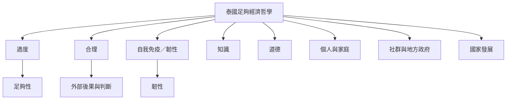

泰國 SEP 可用三項原則與兩項條件理解：適度、合理、自我免疫／韌性；知識與道德。它不只指個人生活方式，也可應用於家庭、社群、組織及國家。重要閱讀問題是理念如何轉成公共服務與地方發展，以及不同政治行動者如何詮釋它。

## Mermaid 關係圖

## 概念連結
[[term/泰國足夠經濟哲學]]、[[term/適度主義]]、[[term/韌性]]、[[term/佛教經濟學]]、[[note/泰國足夠經濟哲學不能直接等同全球後成長理論]]、[[note/韌性來自多層次的互助與公共制度]]。

## 延伸閱讀
[[data/泰國足夠經濟哲學以中道回應全球化風險]]、[[data/1998 年泰王演說將足夠界定為有能力範圍內的適度生活]]、[[data/聯合國開發計畫署以社群賦權重新檢視泰國足夠經濟哲學]]、[[data/泰國足夠經濟的政治嵌入可能改變其解放性意涵]]。

全書：[[Sufficiency_economy]]。
