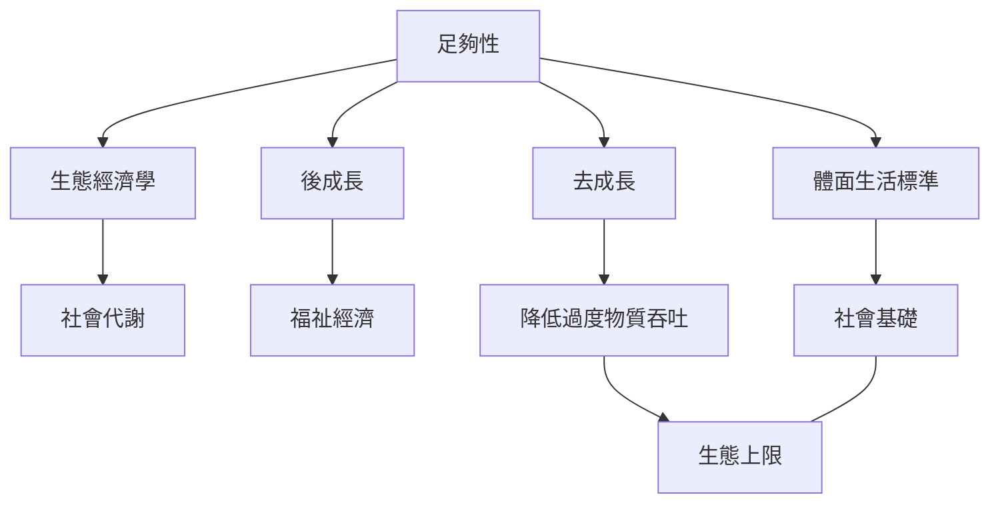

廣義足夠性研究將「夠用」連結生產、消費、物質吞吐、生態限制與分配正義。後成長和去成長提供制度轉型的分析，生態經濟學提供自然系統與經濟之間的物質分析。這些理論有重疊，但各自問題意識與政策主張仍有差異。

## Mermaid 關係圖

## 概念連結
[[term/足夠性]]、[[term/後成長]]、[[term/去成長]]、[[term/生態經濟學]]、[[term/社會代謝]]、[[note/後成長不是停止改善生活而是改變改善的定義]]、[[note/足夠生活需要同時設定社會底線與生態上限]]。

## 延伸閱讀
[[data/足夠性文獻回顧將足夠理解為跨尺度的經濟原則]]、[[data/全球最低能源情境顯示體面生活不必依賴高物質吞吐]]、[[data/2026 年後成長研究提出福祉足夠平等與南北收斂原則]]。

全書：[[Sufficiency_economy]]。
