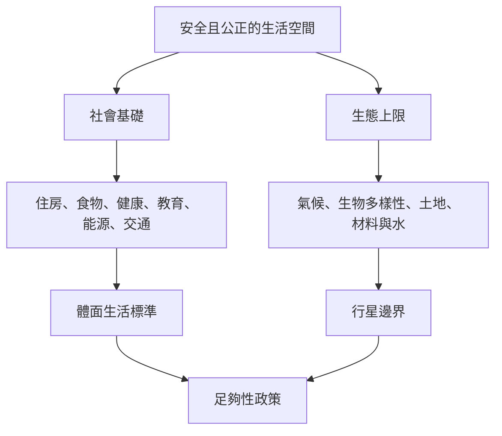

足夠生活需要同時確保人們能獲得基本物質與社會條件，也不超越維持地球生命系統的生態界線。甜甜圈經濟學把兩者視覺化；體面生活標準提供需求面分析，生態經濟學與行星邊界研究則協助理解生態限制。指標應依地方脈絡建構並公開不確定性。

## Mermaid 關係圖

## 概念連結
[[term/甜甜圈經濟學]]、[[term/社會基礎]]、[[term/生態上限]]、[[term/體面生活標準]]、[[term/分配正義]]、[[note/體面生活需要物質底線而非無止境的消費擴張]]。

## 延伸閱讀
[[data/甜甜圈經濟學以社會基礎與生態上限界定安全公正空間]]、[[data/全球最低能源情境顯示體面生活不必依賴高物質吞吐]]。

全書：[[Sufficiency_economy]]。
