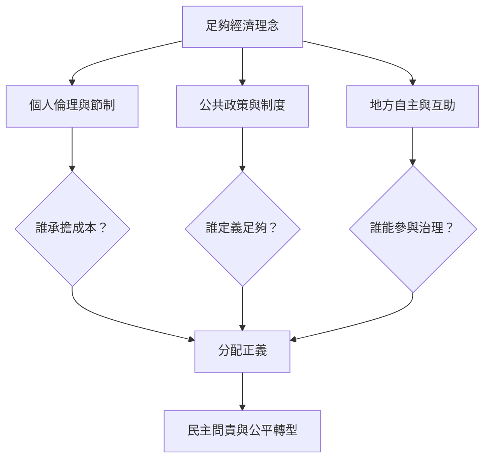

足夠經濟的政治效果取決於誰定義足夠、誰有決策權、誰承擔節制成本及誰取得資源利益。泰國研究提醒 SEP 可能被國家權力重新詮釋，也可能被浪漫化為農村自給生活。廣義足夠性亦需警惕把結構性轉型化約成個人消費道德。

## Mermaid 關係圖

## 概念連結
[[term/分配正義]]、[[term/足夠性政策]]、[[note/節制若只要求個人承擔就會遮蔽結構性不平等]]、[[note/另類經濟理念可能在國家治理中被收編]]、[[note/足夠的定義本身就是政治問題]]。

## 延伸閱讀
[[data/泰國足夠經濟的政治嵌入可能改變其解放性意涵]]、[[data/泰國足夠公民研究揭示節制如何成為治理技術]]、[[data/泰國農業浪漫化批判提醒足夠經濟不能否認農民的多元願望]]。

全書：[[Sufficiency_economy]]。
