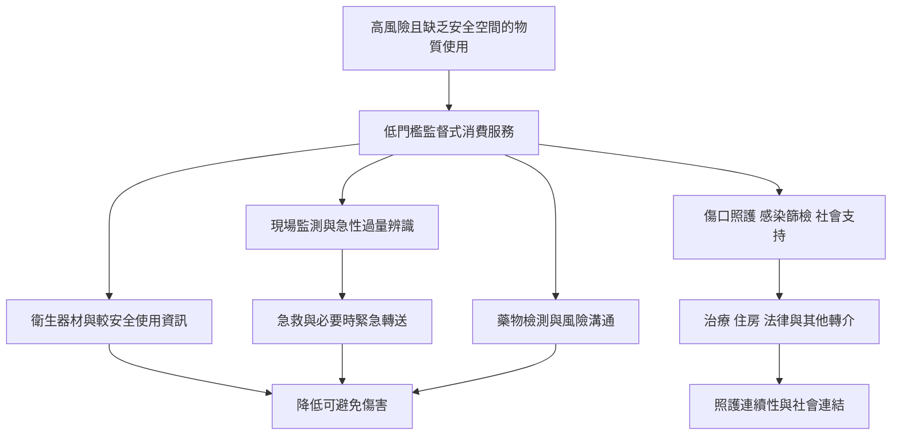

監督式消費服務不是單一設備，而是一組由安全空間、現場監測、急救處置與轉介關係組成的介入機制。理解它需要把服務本身和它所連結的減害網絡放在一起。

核心概念包括[[監督式消費服務]]、[[監督式注射設施]]、[[藥物消費室]]、[[減害]]、[[過量]]、[[納洛酮]]、[[藥物檢測]]、[[針具服務]]與[[鴉片類使用障礙維持治療]]。

## 思與行
* 將每一項服務功能對應到具體風險與轉介路徑。
* 檢查在場內發生急性事件時，工作人員、醫療系統與救護服務如何協作。
* 思考不同使用途徑是否需要不同的空間、設備與訓練。

## 參考
* [[雪梨MSIC長期營運顯示現場過量可被及時處置]]、[[加拿大官方監測顯示監督式消費服務已處理大量非致命過量並提供轉介]]。
* [[監督式消費服務應與藥檢納洛酮針具服務與治療連成照護網]]。
* [[Supervised_injection_site]]。
