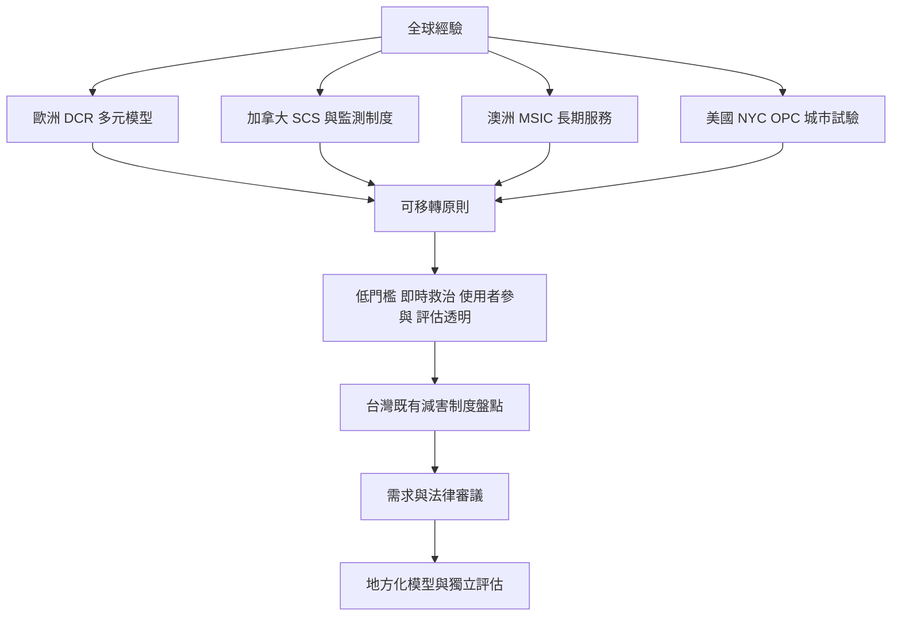

監督式消費服務在歐洲、澳洲、加拿大、美國與其他地區以不同名稱和法律依據運作。全球案例可用來比較服務原則與評估方法，但不能取代台灣自身的法規盤點、地方風險分析與社區審議。

地區案例：[[歐洲在2025年有100處藥物消費室分布於13個歐盟會員國與挪威]]、[[溫哥華Insite開幕後近鄰500公尺範圍的過量死亡率下降35百分比]]、[[雪梨MSIC長期營運顯示現場過量可被及時處置]]、[[法國巴黎與史特拉斯堡評估指出低風險消費室具有公共衛生效益]]、[[紐約監督式消費中心首年記錄636次過量介入且沒有場內死亡]]、[[台灣減害政策以針具服務維持治療與篩檢轉介為重要主軸]]。

## 思與行
* 比較案例時標註國家、法律基礎、服務模式與研究年份。
* 台灣政策研究先確認現有服務缺口，再討論服務模型與試辦條件。

## 參考
* EUDA 2026 指南：[https://www.euda.europa.eu/publications/mini-guides/health-and-social-responses-drug-consumption-rooms_en](https://www.euda.europa.eu/publications/mini-guides/health-and-social-responses-drug-consumption-rooms_en)。
* 衛福部台灣減害政策說明：[https://www.mohw.gov.tw/cp-7404-88143-1.html](https://www.mohw.gov.tw/cp-7404-88143-1.html)。
* [[為台灣建立監督式消費服務的審議與試辦評估框架]]、[[Supervised_injection_site]]。
