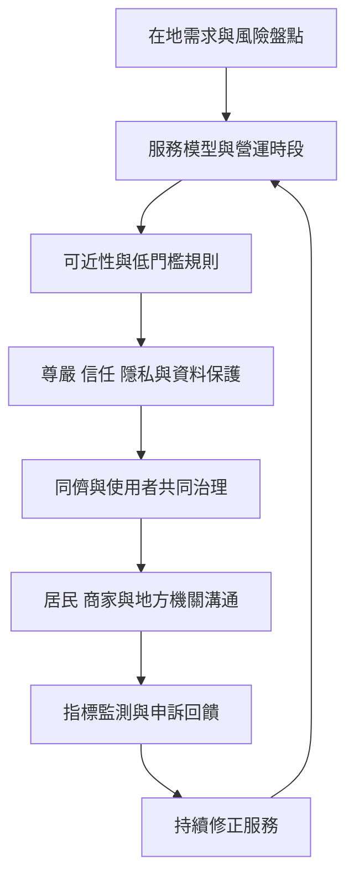

服務品質取決於是否能真正進入、是否被尊重、是否與其他照護連結，以及社區是否有穩定的溝通與修正機制。低門檻不是放棄規範，而是讓規範以必要、透明、比例適當的方式支持安全。

核心連結：[[低門檻服務的有效性取決於實際可近性而非形式存在]]、[[監督式消費服務必須把尊嚴與信任視為服務基礎]]、[[社區安全與使用者權利並非互斥目標]]。

## 思與行
* 讓服務使用者與有生活經驗者參與規則形成與執行評估。
* 公開服務規則、申訴機制與資料使用目的。
* 把未使用者的經驗納入服務改善，辨識被制度排除的人。

## 參考
* [[服務規則與警察監控會形成使用者進入監督式消費服務的障礙]]、[[雅典使用者經驗指出安全感提升仍需克服污名與服務門檻]]。
* [[把服務使用者共同治理納入設施設計與評估]]、[[以交通時間與服務時段繪製真正的可近性地圖]]。
* [[Supervised_injection_site]]。
