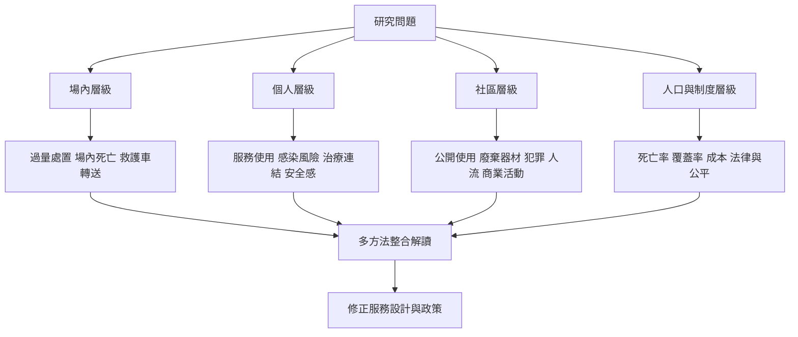

監督式消費服務的效果必須依照分析層級區分：場內事件能否被救治、個人是否獲得更安全的照護、鄰里公共空間是否改善，以及人口層級死亡率是否改變。不同問題需要不同研究方法，不能以單一指標代替全部答案。

重要連結：[[場內零死亡不能直接等同城市整體死亡率下降]]、[[評估服務應同時測量個人社區和制度三個層級]]、[[監督式消費服務的因果證據需要區分場內效果與外溢影響]]、[[藥物消費室研究方法應結合個人資料社區指標與執行脈絡]]。

## 思與行
* 在服務啟動前決定基線、比較區、指標、期間與資料治理。
* 對無顯著差異與不確定性保持公開，避免只呈現有利數字。

## 參考
* [[監督式消費服務對人口層級過量死亡率的影響仍未有一致結論]]、[[紐約研究未發現監督式消費中心開設後犯罪與失序指標顯著增加]]、[[紐約2026年研究未發現監督式消費中心對鄰近商業活動有顯著影響]]。
* [[Supervised_injection_site]]。
