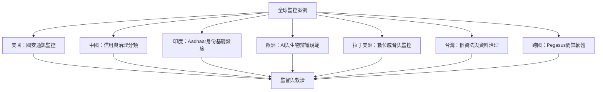

不同地區案例呈現監控的多種制度樣態：國家安全、身份福利、平台商業、職場管理與跨國間諜軟體。比較時應分辨各地制度脈絡，並以人權與資料治理原則建立共同問題。

* [[美國國安監控案例凸顯秘密權力需要獨立監督]]
* [[中國社會信用研究提醒我們區分多元治理機制與流行迷思]]
* [[印度Aadhaar案例顯示生物辨識失誤可能阻斷基本權利]]
* [[Pegasus案例顯示商業間諜軟體能把監控外包成跨國服務]]
* [[台灣個人資料保護法提供資料蒐集處理與利用的基本法律框架]]
