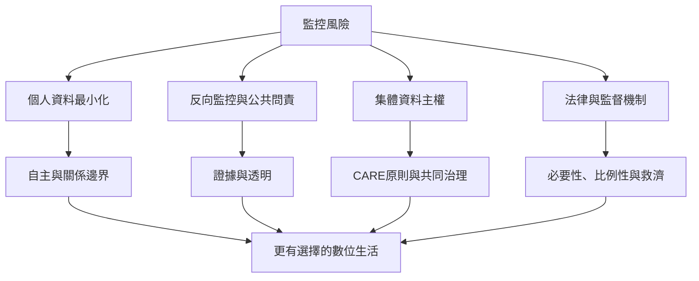

抵抗監控不只等於隱藏個資，也包括反向記錄、限制目的、集體資料治理、權利救濟與創造不必持續量測的生活空間。個人策略與制度改革需要互補。

* [[為生活建立資料最小化而非全面拒用科技的實踐清單]]
* [[原住民族資料治理要求資料使用回應集體利益與自決]]
* [[反向監控讓被觀察者也能記錄監控者的行動]]
* [[監控影響評估應先檢驗必要性與比例性]]
* [[適度不被量測的空間是自由與即興生活的重要條件]]
