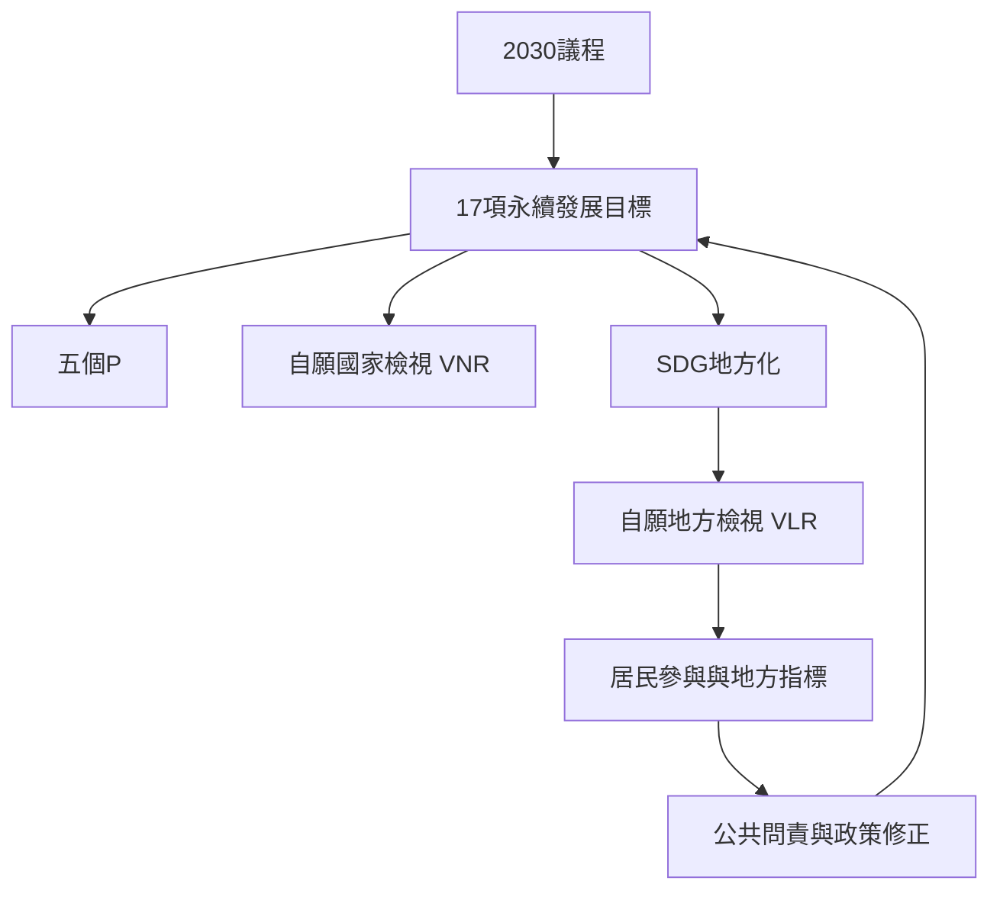

SDGs 以 2030 議程為共同框架，透過五個 P、國家檢視與地方檢視，讓國際承諾進入公共政策。這套治理架構的核心挑戰，是如何在共同目標與地方自主之間形成雙向翻譯。

概念連結：[[2030議程]]、[[永續發展目標]]、[[五個P]]、[[SDG地方化]]、[[自願國家檢視]]、[[自願地方檢視]]、[[政策一致性]]。

洞見連結：[[全球目標必須由地方制度與生活經驗共同實現]]、[[地方化不是政策下放而是共同翻譯]]、[[地方檢視應形成持續的公共回饋循環]]。

案例來源：[[台北市2025自願地方檢視以市民參與與淨零生活連結十七項目標]]、[[韓國華城市2024自願地方檢視把公民共同制定目標納入城市治理]]、[[菲律賓地方政府2025自願地方檢視把傾聽需求連結到地方規劃]]、[[印度喀拉拉邦地方自治體案例展示SDG地方化與人民規劃的連結]]。
