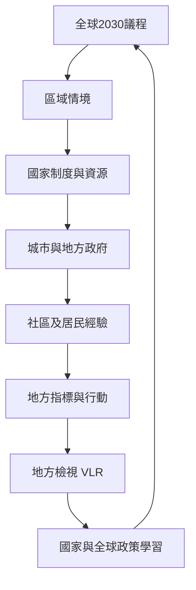

同一套全球目標會在不同區域形成不同的發展瓶頸。區域報告可指出結構與趨勢，地方案例則展示公民參與、政策調整和地方制度如何創造具體路徑。

概念連結：[[SDG地方化]]、[[自願地方檢視]]、[[多元世界觀]]、[[參與式預算]]、[[資料分解]]。

洞見連結：[[全球平均數可能掩蓋區域與群體差異]]、[[全球目標必須由地方制度與生活經驗共同實現]]、[[多元世界觀能避免單一發展模式壟斷未來想像]]。

區域材料：[[亞太2026進度報告指出區域發展成果被環境惡化與不平等抵銷]]、[[非洲2026永續發展報告將2030議程與非洲聯盟2063議程並行檢視]]、[[拉丁美洲與加勒比2026報告估計僅19％目標可能於2030年達成]]、[[阿拉伯區域2025報告呈現衝突資源稀缺與發展差距的交疊]]、[[歐洲2025報告顯示高收入地區仍有生態與生物多樣性缺口]]。
