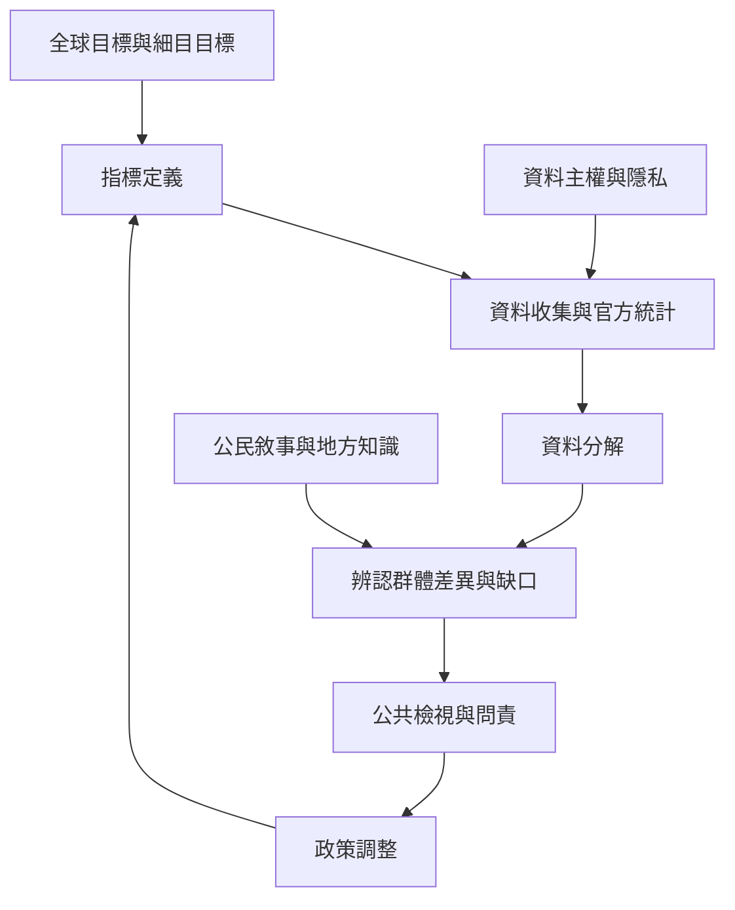

SDG 指標將共同承諾轉化為可追蹤資訊，但資料覆蓋、分類、方法與治理方式會決定誰被看見。監測必須同時處理資料品質、資料缺口、分解分析、質性證據與權利保障。

概念連結：[[SDG指標]]、[[資料分解]]、[[資料主權]]、[[不遺漏任何人]]、[[人權取徑]]。

洞見連結：[[指標是政治選擇而非中立鏡子]]、[[聯合國官方進度與獨立指數回答的是不同問題]]、[[永續政策需要多種知識傳統互相檢驗]]。

來源：[[聯合國2026監測報告提醒資料基礎設施本身也是公共治理]]、[[指標制定的過程會重新界定何謂重要的發展問題]]、[[聯合國2026年進度報告顯示全球目標仍遠未走上正軌]]、[[SDSN 2026永續發展報告以獨立指數指出僅少數目標進度符合軌道]]。
