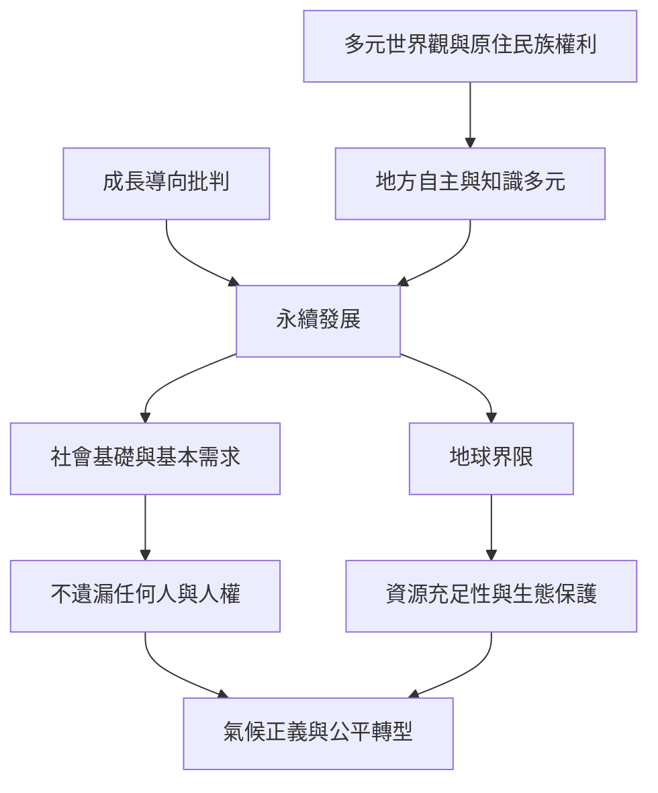

永續發展必須同時面對基本需求、地球界限、權利、歷史責任與多元生活願景。SDGs 的整合語言有助協作，但其成長假設、指標政治與普遍化的發展觀也需要持續檢驗。

概念連結：[[永續發展]]、[[地球界限]]、[[甜甜圈經濟]]、[[資源充足性]]、[[去成長]]、[[氣候正義]]、[[公平轉型]]、[[人權取徑]]、[[原住民族權利]]、[[多元世界觀]]。

洞見連結：[[生態界限必須與社會基礎一起衡量]]、[[經濟成長不是永續發展的充分條件]]、[[原住民族是發展議程的共同決策者而非政策對象]]、[[人權取徑使永續承諾具有可問責的義務關係]]。

來源：[[地球界限研究指出基本生活需求可與較低資源消耗並行]]、[[Hickel以成長與生態衝突批判永續發展目標內部矛盾]]、[[Pluriverse提出多元世界觀作為主流發展模式的替代參照]]、[[聯合國原住民族議程要求原住民族權利進入永續發展監測]]。
