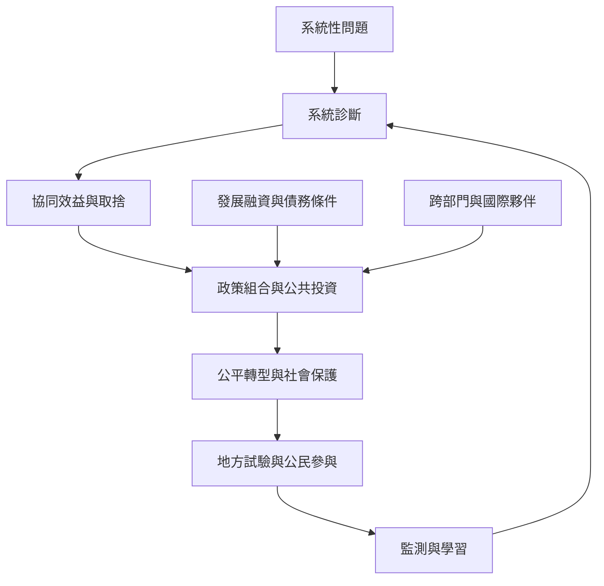

SDG 加速不只是增加專案數量，而是改變食物、能源、數位、教育、工作與環境等系統。轉型要有融資、制度和技術，也要處理利益分配、勞工、地方知識與民主正當性。

概念連結：[[系統思考]]、[[系統轉型]]、[[SDG互動]]、[[政策一致性]]、[[公平轉型]]、[[國際外溢效應]]、[[參與式預算]]。

洞見連結：[[六項系統轉型能把目標連成政策組合]]、[[發展融資的國際分配也是權力關係]]、[[債務成本會壓縮公共服務與政策自主]]、[[公平轉型必須處理成本工作與決策權]]。

來源：[[全球永續發展報告2023主張以系統轉型取代零碎漸進措施]]、[[UNCTAD估計發展中國家每年仍有43000億美元永續發展融資缺口]]、[[綠色轉型研究指出轉型路徑始終涉及權力與政治聯盟]]、[[永續發展目標互動研究提出辨認協同效益與取捨的方法]]。
