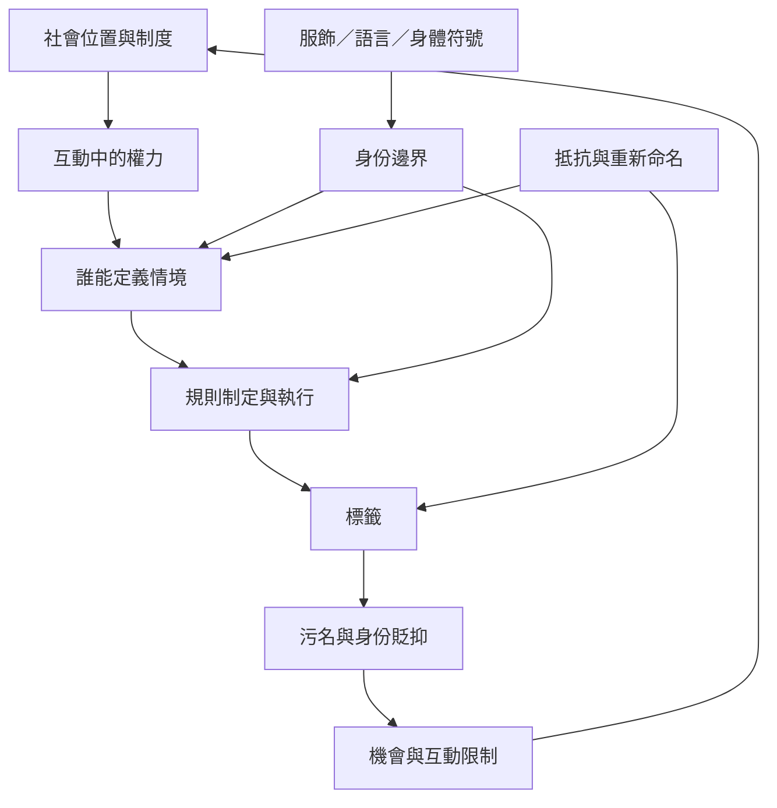

象徵互動論不應只描述參與者如何協商意義，還要分析誰能定義情境、誰的分類具有制度效力、誰承受污名與排除。這張地圖把標籤、污名、社會角色、權力與日常身份邊界連接起來。

## 思與行
* 研究任何標籤時，追問誰有命名權、命名依據與制度後果。
* 將 [[標籤理論]]、[[污名]] 與 [[互動中的權力來自定義權與資源分配]] 一起閱讀。
* 以 [[國族身份在日常符號實作中被反覆界定]] 對照身份邊界如何被日常化。

## 參考
* [[象徵互動論可以分析權力而不只描述微觀互動]]、[[標籤會改變他人如何對待一個人也會改變其行動機會]]、[[阿聯酋日常服飾與語言實作參與國族身份的建構]]。
* 全書導讀：[[Symbolic_interactionism]]。
