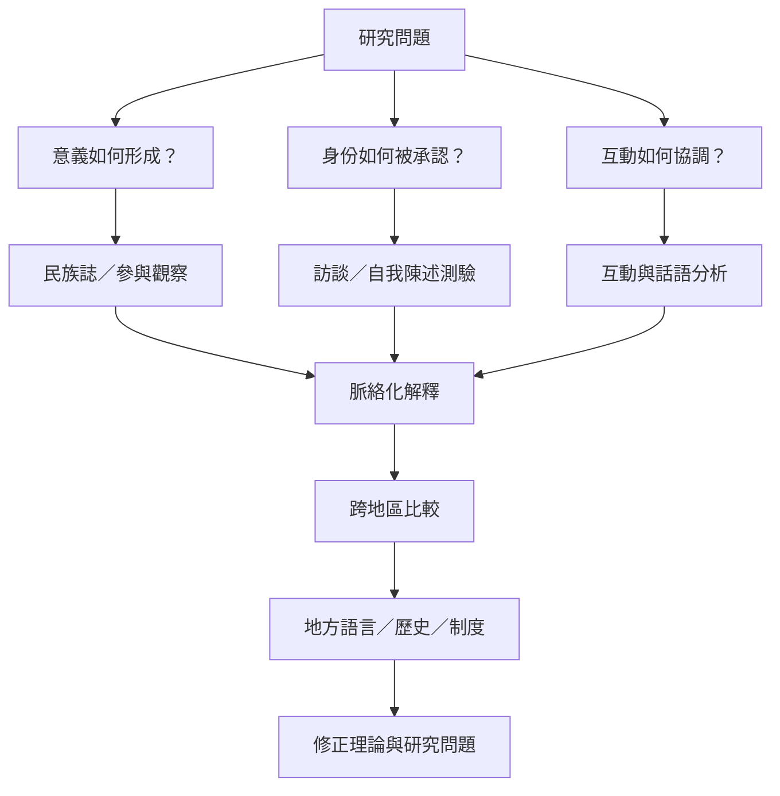

象徵互動論的研究方法需對準意義形成與行動協調的過程。民族誌、訪談、互動分析、問卷與混合方法各有用途。跨文化研究則要避免將美國理論脈絡當成普遍模板，需讓地方歷史、語言與制度進入分析。

## 思與行
* 將 [[民族誌]] 與 [[互動研究方法必須對準所要理解的過程]] 作為研究設計入口。
* 以中國與海灣地區的研究案例對照理論概念如何在地方脈絡中變化。
* 擴充時優先納入非英語研究與研究者自身的概念，而不是只找理論的海外例證。

## 參考
* [[芝加哥與愛荷華學派採取不同的互動研究策略]]、[[象徵互動論的全球研究需要避免把美國經驗當成普遍模型]]、[[象徵互動論的當代研究已延伸至權力性別科技與環境]]。
* 全書導讀：[[Symbolic_interactionism]]。
