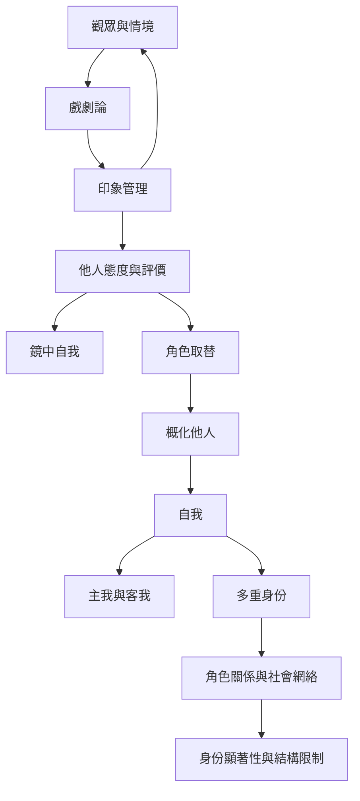

此圖聚焦自我如何在重要他人、概化他人、角色網絡及具體觀眾之間形成。Mead 的自我理論、Cooley 的鏡中自我、Stryker 的身份理論與 Goffman 的戲劇分析彼此相連，但理論焦點不同。

## 思與行
* 以 [[自我]] 作為入口，分別閱讀 [[鏡中自我]]、[[角色取替]] 與 [[身份理論]]。
* 研究個人呈現時，使用 [[印象管理]] 與 [[戲劇論]]，但不要把它們直接等同於全部象徵互動論。

## 參考
* [[自我不是孤立內在物而是在關係中形成]]、[[自我身份既具多重性也受角色網絡限制]]、[[戲劇論能揭示自我呈現但不等於整個象徵互動論]]。
* 全書導讀：[[Symbolic_interactionism]]。
