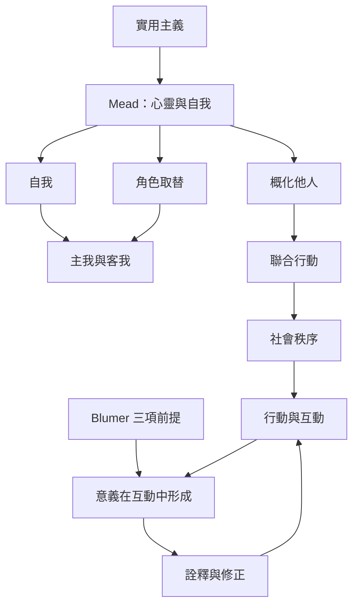

本概念地圖從實用主義與 Mead 的社會心理學出發，整理象徵互動論如何透過符號、意義、角色取替與聯合行動理解社會秩序。重點不是列出人物，而是追蹤「意義—詮釋—行動—回饋」的循環。

## 思與行
* 閱讀順序可由 [[實用主義]]、[[米德把自我理解為社會互動形成的過程]]，再讀 [[布魯默提出象徵互動論三項前提]]。
* 以 [[情境定義]] 和 [[聯合行動]] 作為觀察日常互動的入口。

## 參考
* [[象徵互動論將社會理解為互動中持續生成的意義秩序]]、[[主我與客我使自我同時具有創造性與社會性]]、[[概化他人使群體規範進入個人行動]]。
* 全書導讀：[[Symbolic_interactionism]]。
