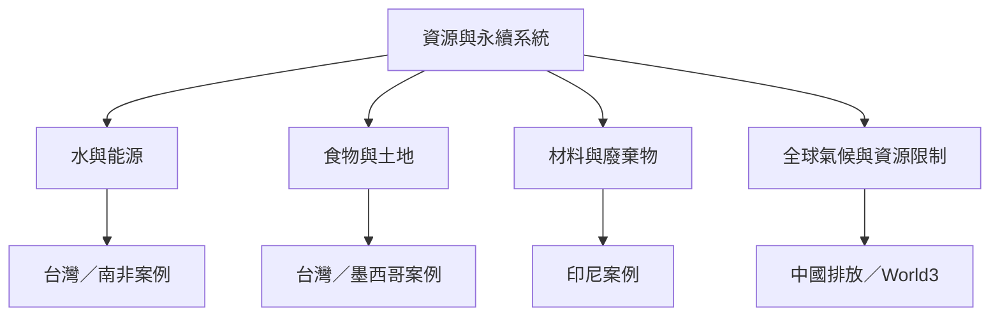

這張地圖連結不同地區的案例，觀察系統動力學如何處理跨部門資源、環境壓力與公共政策。台灣與南非的水能源案例、印尼塑膠廢棄物、中國能源排放、World3 全球模型及墨西哥城市農園研究，呈現同一方法如何因問題尺度與制度情境而改變。

概念節點：[[資源關聯]]、[[世界3模型]]、[[城市代謝]]、[[循環經濟]]、[[全球永續]]、[[公共衛生]]、[[水資源管理]]、[[能源轉型]]、[[廢棄物治理]]。

脈絡入口：[[System_dynamics]]
