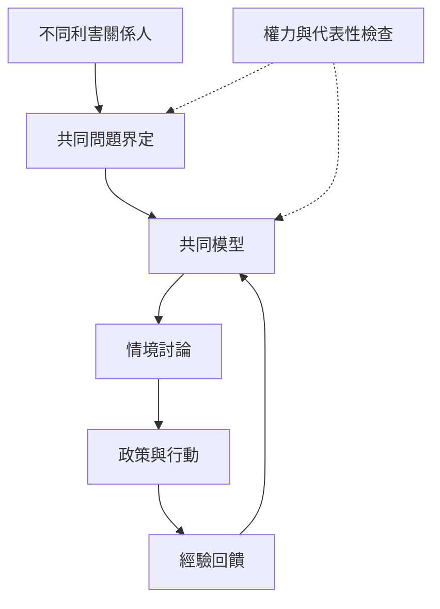

此地圖強調模型不是價值中立的鏡子。模型邊界、參與者組成、資料來源和決策權都會影響最後呈現的系統。參與式系統動力學的價值在於把分散知識帶入共同建模，但必須檢查發言權、缺席者與公平性。

概念節點：[[參與式系統動力學]]、[[團體模型建構]]、[[模型邊界]]、[[團體學習]]、[[公共衛生]]、[[公平性]]、[[知識共創]]、[[行動研究]]。

脈絡入口：[[System_dynamics]]
