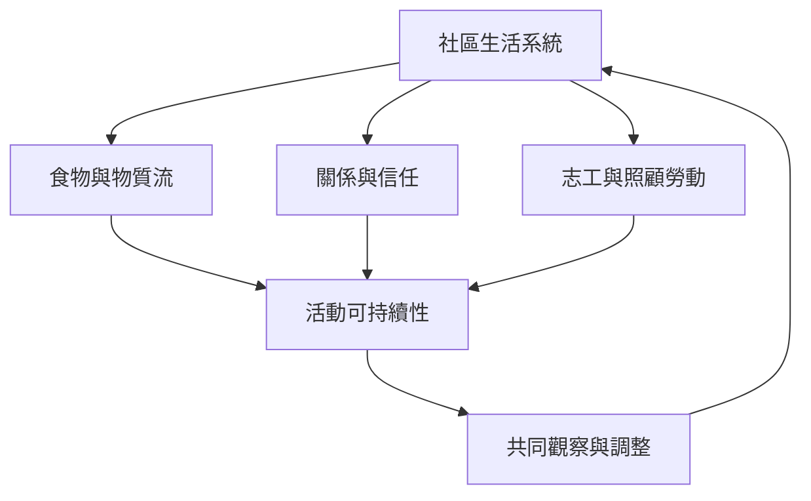

此地圖把系統動力學帶入生活與社區：食物分享、志工組織、社群聚會、個人習慣與活動資源盤點。重點不是把生活變成效率儀表板，而是用簡單模型看見累積、互賴、負擔分配與可持續性，並以小型實驗修正假設。

概念節點：[[續食餐桌]]、[[志工服務]]、[[社區治理]]、[[習慣形成]]、[[資源關聯]]、[[行動研究]]、[[強化迴路]]、[[調節迴路]]、[[團體學習]]。

脈絡入口：[[System_dynamics]]
