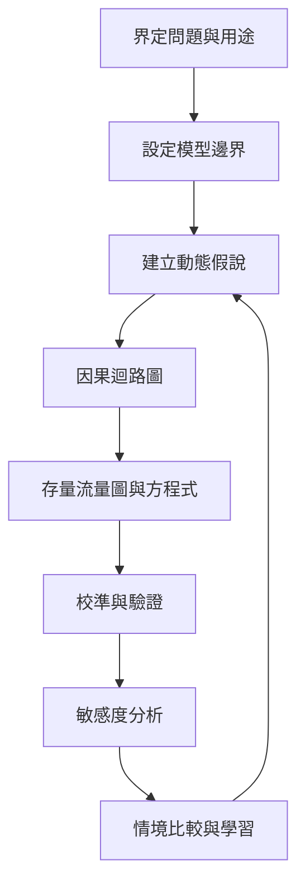

這張地圖整理從問題界定、模型邊界、動態假說、因果迴路、存量流量、方程式，到校準、驗證、敏感度與情境分析的工作流程。模型品質不等於曲線漂亮，而是模型結構適合回答明確問題，假設可被檢查，輸出能支持學習。

概念節點：[[模型邊界]]、[[內生性]]、[[外生變數]]、[[動態假說]]、[[因果迴路圖]]、[[存量流量圖]]、[[校準]]、[[模型驗證]]、[[敏感度分析]]、[[情境分析]]、[[系統動力學]]。

脈絡入口：[[System_dynamics]]
