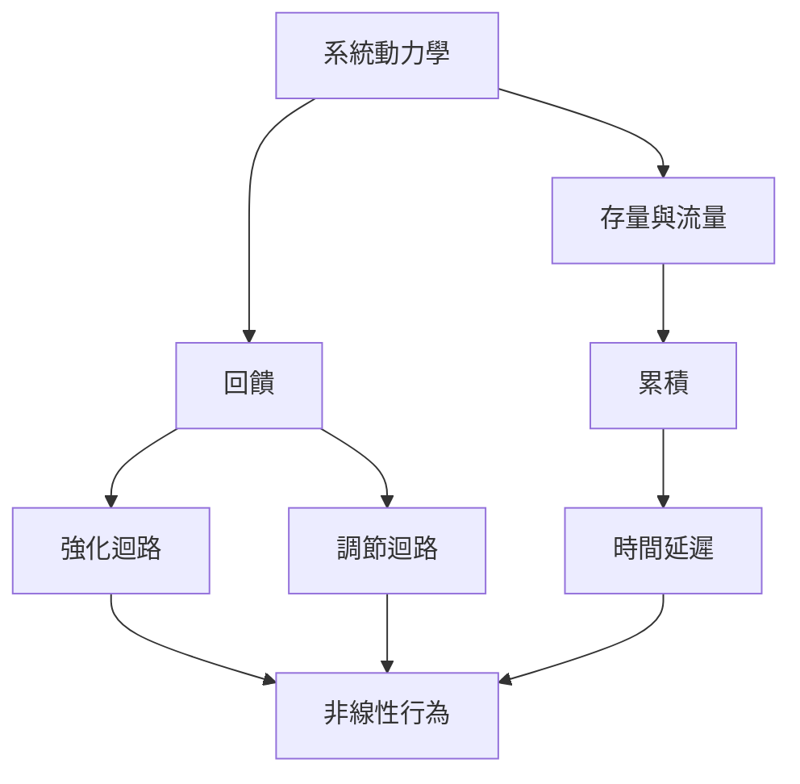

這張概念地圖從系統動力學的核心結構出發：回饋決定變化如何被放大或抵銷，存量與流量決定累積，時間延遲與非線性則讓行為呈現反直覺的路徑。先理解這組結構，再閱讀模型方法與案例。

概念節點：[[系統動力學]]、[[系統思考]]、[[回饋]]、[[存量]]、[[流量]]、[[累積]]、[[強化迴路]]、[[調節迴路]]、[[時間延遲]]、[[非線性]]、[[因果迴路圖]]、[[存量流量圖]]、[[動態複雜性]]。

脈絡入口：[[System_dynamics]]
