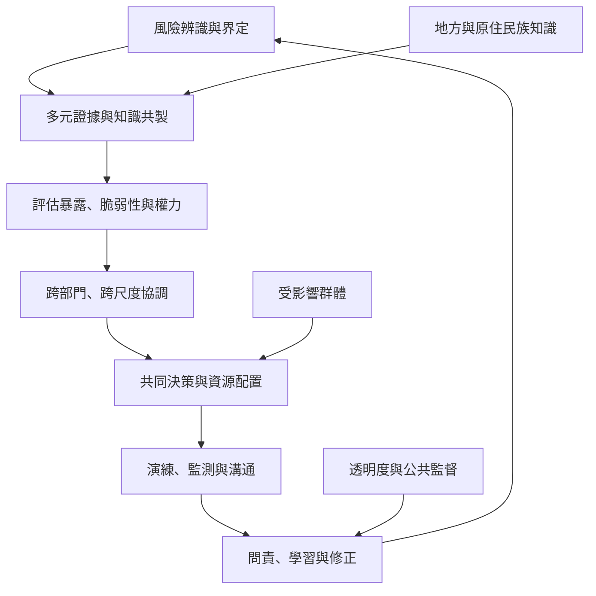

系統性風險治理不能停留在跨部門會議；它還必須處理誰有權定義風險、誰掌握資源、誰提供知識，以及誰承擔政策副作用。跨域協調若缺乏問責與公平，可能只把既有權力差異延伸到危機治理。

可由[[風險治理]]、[[風險社會]]、[[地方知識]]、[[知識共製]]、[[脆弱性]]與[[多重危機]]理解治理面向。相關筆記包括[[風險治理若按部門切割便會漏掉跨域傳播]]、[[風險治理必須同時處理知識與權力]]、[[地方與原住民族知識是風險治理能力而非裝飾性參與]]、[[相同衝擊會因暴露脆弱與適應能力差異造成不平等結果]]及[[風險回應也可能製造新的脆弱性]]。
