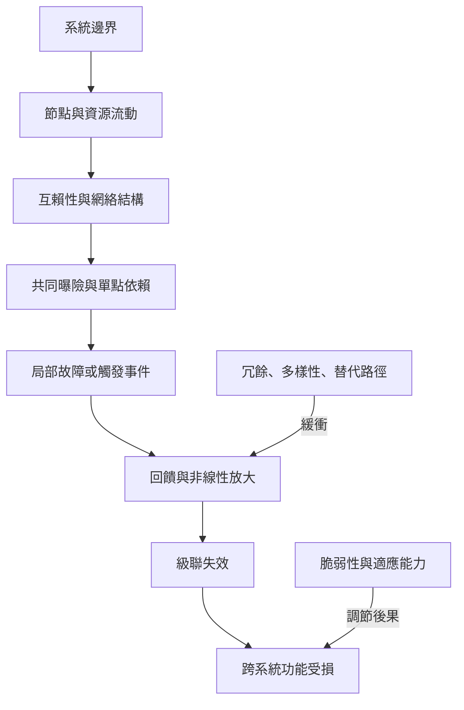

系統性風險分析首先要辨識系統邊界、節點、流動與依賴關係，再追蹤壓力如何透過回饋與級聯影響擴散。這張概念地圖把結構、動態機制與結果放在同一條分析路徑上。

這張圖的核心概念包括[[系統性風險]]、[[互賴性]]、[[複雜系統]]、[[級聯失效]]、[[回饋循環]]、[[臨界點]]、[[關鍵基礎設施]]與[[網絡中心性]]。相關論點可參考[[系統性風險的本質是傳播機制而不是事件規模]]、[[系統邊界決定風險分析看得見什麼]]、[[高度互賴提高效率也可能擴大共同失效]]、[[正回饋與非線性使小擾動可能放大為級聯危機]]及[[韌性需要多樣性冗餘與可替代性]]。
