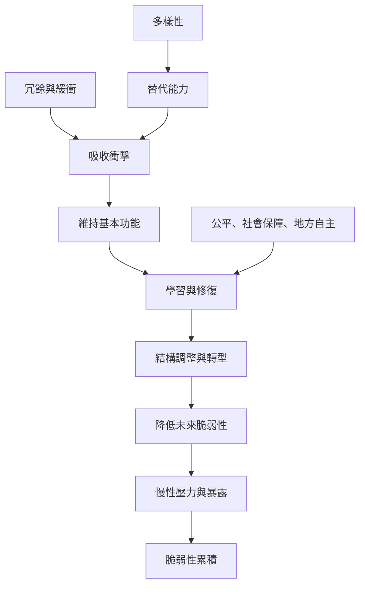

韌性不是單純吸收衝擊或回到災前狀態，而是維持重要功能、學習、調整並降低原有脆弱性。系統需要可實際啟用的備援，也需要公平的資源分配與社區自主能力，避免把「韌性」變成要求弱勢者自行承擔危機的話語。

此圖連結[[韌性]]、[[脆弱性]]、[[地方知識]]、[[社會生態系統]]與[[互賴性]]。相關筆記包括[[韌性不是恢復原狀而是降低原有脆弱性]]、[[韌性需要多樣性冗餘與可替代性]]、[[預防性投資容易被短期政治與預算制度低估]]、[[地方與原住民族知識是風險治理能力而非裝飾性參與]]。
