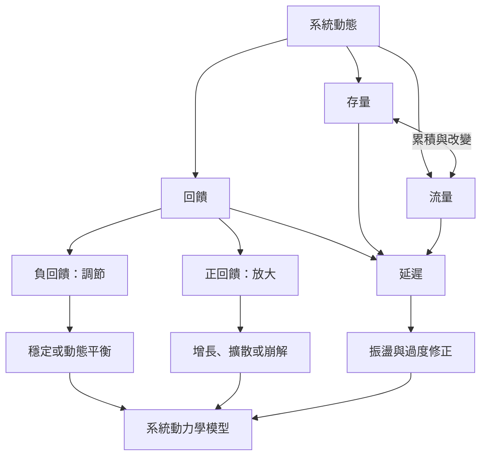

本圖聚焦系統為何會隨時間出現穩定、增長、振盪或失控。存量與流量構成動態基礎，回饋將結果帶回原因，延遲則改變回應的時機與強度。系統動力學將這些關係轉成可檢查的模型。

## 延伸閱讀
* [[系統動力學以存量流量與回饋解釋時間中的系統行為]]
* [[存量與流量的差異是理解延遲與慣性的起點]]
* [[負回饋維持調節正回饋放大偏離]]
* [[系統動力學]]
* [[存量]]
* [[流量]]
* [[回饋]]
* [[延遲]]
