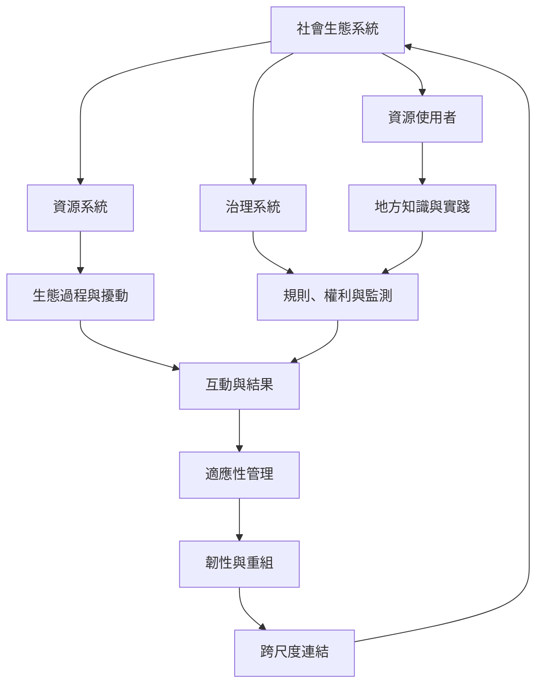

社會生態系統把自然資源、資源使用者、治理規則與行動結果放在同一架構。韌性與跨尺度研究進一步關注擾動、適應、重組以及地方知識如何進入共同治理。

## 延伸閱讀
* [[社會生態系統不可把人與自然拆成獨立部門]]
* [[地方知識只有進入共同治理才能轉成系統學習]]
* [[韌性不等於恢復原狀而是維持重要功能的適應能力]]
* [[社會生態系統]]
* [[韌性]]
* [[跨尺度連結]]
* [[自組織]]
