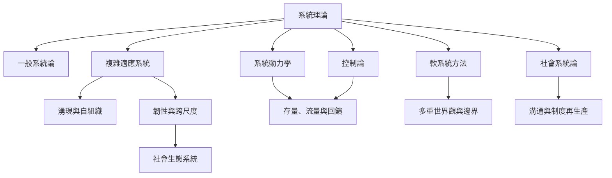

這張地圖把系統理論視為數個相互關聯但不可混同的研究傳統：一般系統論提供跨領域比較語言，控制論研究調節與通訊，系統動力學分析時間中的回饋，複雜適應系統處理湧現與適應，社會生態與社會系統論則把制度、自然與溝通帶入分析。

## 延伸閱讀
* [[系統理論是一組互補框架而非單一普遍定律]]
* [[系統]]
* [[系統邊界]]
* [[控制論]]
* [[系統動力學]]
* [[複雜適應系統]]
* [[軟系統方法]]
* [[社會生態系統]]
* [[社會系統論將溝通視為社會系統延續的基本操作]]
