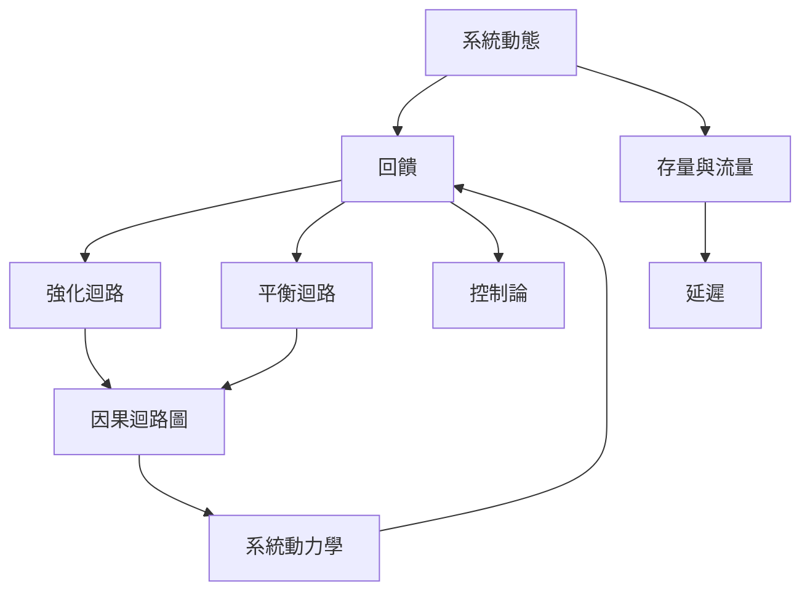

系統動態來自存量的累積、流量的變化、回饋的增強或抑制，以及資訊與行動的時間差。因果迴路圖適合表達假設，系統動力學則可進一步探索隨時間變化的行為。

## 概念連結
* [[回饋]]
* [[強化迴路]]
* [[平衡迴路]]
* [[存量與流量]]
* [[延遲]]
* [[因果迴路圖]]
* [[系統動力學]]
* [[控制論]]

* [[自我調節]]

## 參考
* 基礎文獻：[[介入系統時應先辨識深層規則而非只調整表面參數]]、[[系統、控制論與複雜性科學提供互補而非互斥的分析視角]]。
