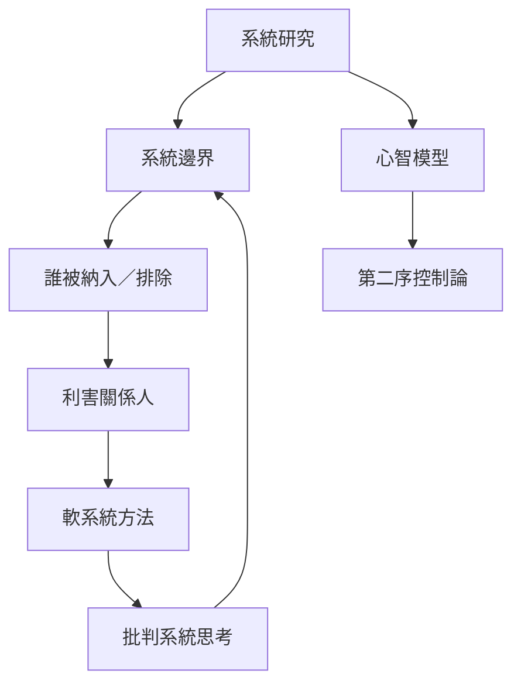

系統分析不是價值中立的全景圖。邊界、分類、資料與成功指標都涉及權力。第二序控制論提醒觀察者也在系統之內；批判與關係性視角則要求讓缺席者、知識差異及歷史責任進入分析。

## 概念連結
* [[批判系統思考]]
* [[第二序控制論]]
* [[系統邊界]]
* [[心智模型]]
* [[利害關係人]]
* [[軟系統方法]]

## 延伸地圖
[[系統由要素關係邊界與湧現共同構成]]、[[系統介入需要選擇槓桿點與方法]]。

* [[去殖民系統思考]]
* [[知識多元]]
* [[關係性系統思考]]
* [[去殖民方法論]]
* [[權力]]
* [[外部性]]
* [[觀點協商]]

## 參考
* 批判與跨文化研究：[[原住民族關係知識要求系統研究者承認自己也是世界的參與者]]、[[系統變革必須在批判結構不公與促成現場協商之間保持張力]]。
