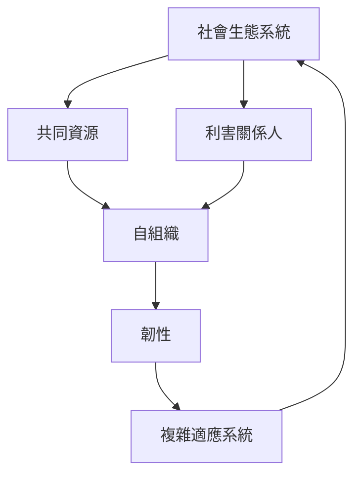

社會與自然不是兩套互不相干的系統。資源特徵、使用者、治理規則與生態過程共同形塑結果；自組織、學習與制度適應可能支持韌性，但須同時檢查不平等和照顧成本。

## 概念連結
* [[社會生態系統]]
* [[共同資源]]
* [[韌性]]
* [[自組織]]
* [[複雜適應系統]]
* [[利害關係人]]

* [[互助]]
* [[適應性治理]]
* [[照顧倫理]]
* [[分散式治理]]
* [[公共衛生]]

## 參考
* 案例研究：[[共享資源能否永續取決於生態條件與制度安排的共同作用]]、[[拉丁美洲城市健康可透過社區共同建模辨識政策槓桿]]。
