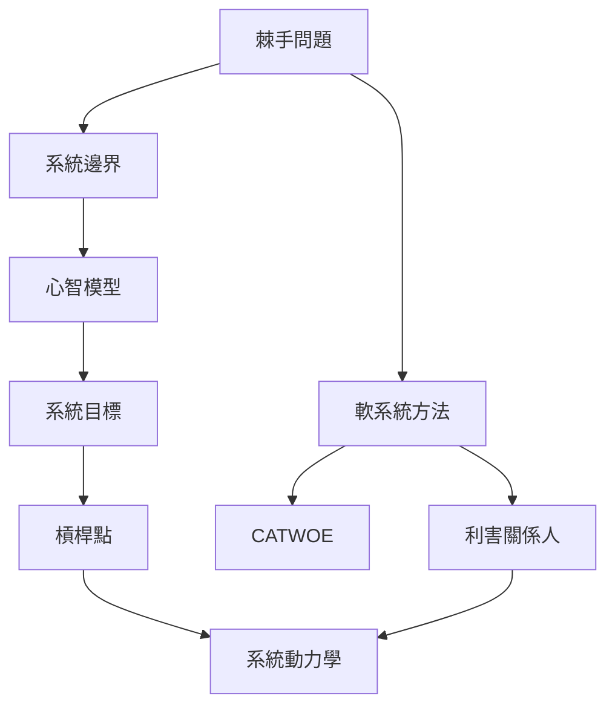

介入前先界定問題情境與系統目標，再依資料、價值衝突和參與者選擇方法。槓桿點提供介入深度的思考框架；軟系統方法適合多重世界觀並存的問題，系統動力學適合追蹤動態結構。

## 概念連結
* [[槓桿點]]
* [[系統目標]]
* [[心智模型]]
* [[系統動力學]]
* [[軟系統方法]]
* [[CATWOE]]
* [[棘手問題]]

## 延伸地圖
[[批判與關係性視角讓系統思考看見權力]]。

* [[共同建模]]
* [[觀點協商]]
* [[方法論多元主義]]
* [[權力]]
* [[外部性]]

## 參考
* 方法與實踐：[[軟系統方法先促進對問題情境的共同理解再討論改善]]、[[介入系統時應先辨識深層規則而非只調整表面參數]]。
