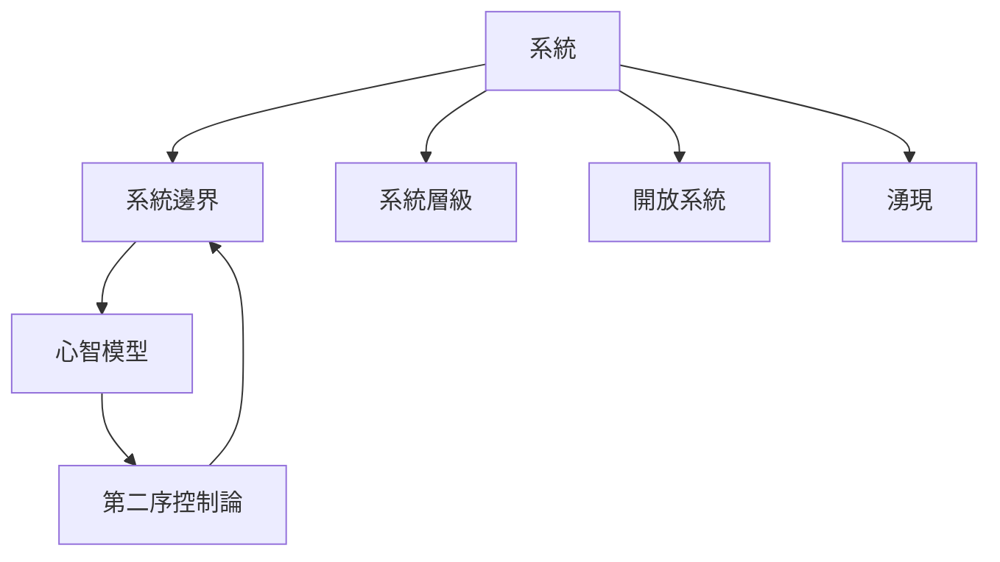

系統觀的起點不是把世界無限擴大，而是辨識要素、關係、邊界、層級與環境交換。整體可能產生個別部分不具備的性質；而觀察者如何畫邊界，也會改變模型能看見的現象。

## 概念連結
* [[系統]]
* [[系統邊界]]
* [[系統層級]]
* [[開放系統]]
* [[湧現]]
* [[心智模型]]
* [[第二序控制論]]

## 延伸地圖
[[批判與關係性視角讓系統思考看見權力]]。

* [[熵]]
* [[知識管理]]

## 參考
* 理論綜述：[[系統、控制論與複雜性科學提供互補而非互斥的分析視角]]、[[系統思考的教育應教導概念差異而非只教畫圖]]。
