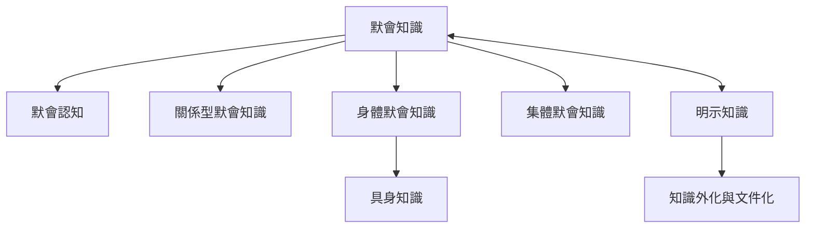

本圖整理默會知識的基本哲學主張、不同知識類型，以及研究時需要區分的概念。核心不是把一切不可言說的東西歸為一類，而是辨識其難以表達的原因與所在層次。可從[[默會知識]]起步，再比較[[關係型默會知識]]、[[身體默會知識]]與[[集體默會知識]]。

關聯概念：[[默會知識的學習、實踐與傳承]]、[[默會知識的治理、權力與公共價值]]。

## 延伸閱讀
* [[默會知識是行動得以成立的背景，而非知識的殘缺版本]]
* [[默會知識的難以言說不等於它完全不能被研究]]
* [[「默會知識」至少包含關係型、身體型與集體型三種不同難題]]
* [[默會知識的研究必須分辨概念與測量]]
