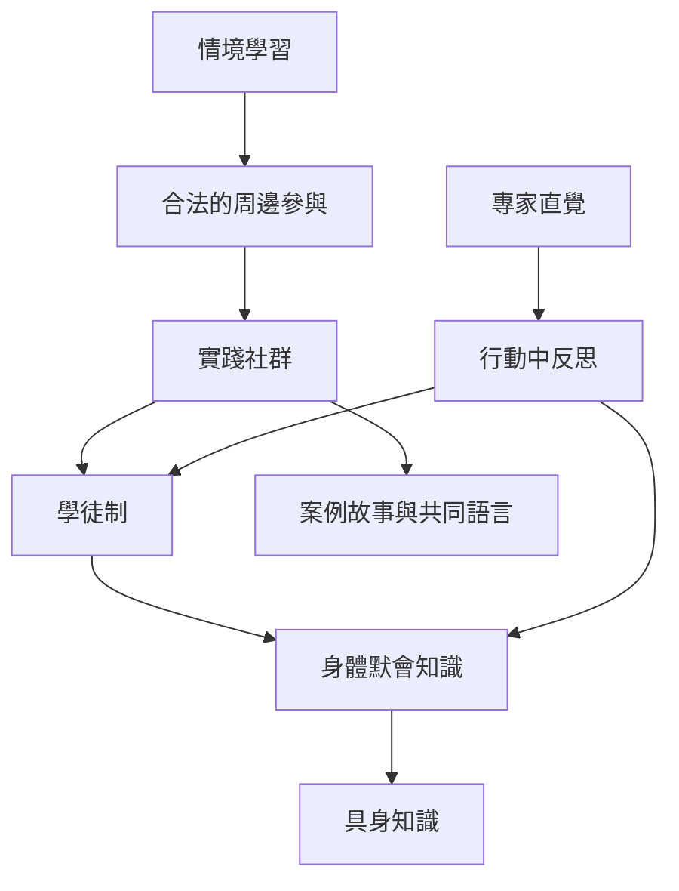

默會知識通常透過參與、模仿、身體操作、共同工作、案例故事與反思而逐步形成。這個概念地圖把個人技能發展放回社群與實作情境，說明學徒制、實踐社群與具身知識如何相互連結。

關聯概念：[[默會知識的哲學基礎與類型]]、[[默會知識的組織創造與決策應用]]。

## 延伸閱讀
* [[學習發生於參與，而不只是資訊接收]]
* [[學徒制保存的不只是技法，也包括判斷與身份]]
* [[故事是默會知識在工作社群中的傳遞媒介]]
* [[設計觀察、模仿、操作、反思與教學的技能傳承循環]]
