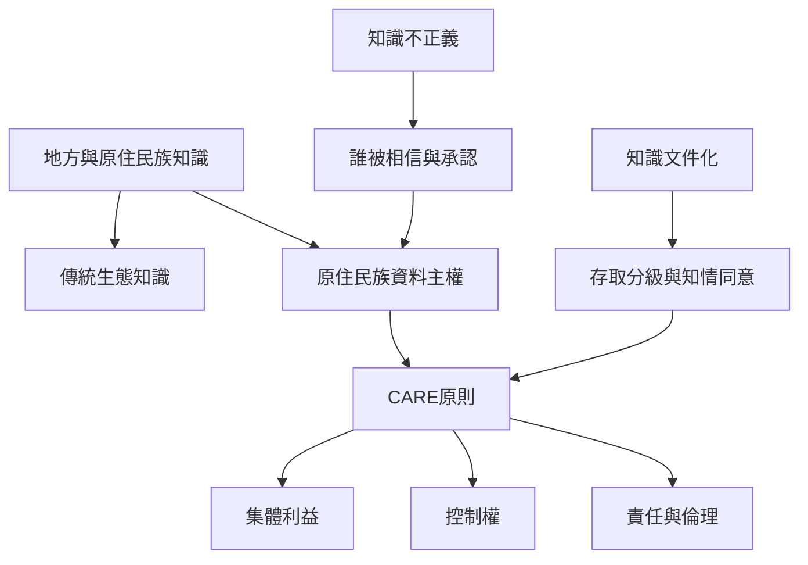

知識傳承與文件化從來不是中性的技術問題。誰能參與、誰的經驗被承認、誰能決定資料用途與分享範圍，都會影響知識能否延續以及成果由誰受益。地方與原住民族知識尤其需要把文化脈絡、資料主權、知情同意與利益分享納入知識治理。

關聯概念：[[默會知識的哲學基礎與類型]]、[[默會知識的學習、實踐與傳承]]、[[默會知識的組織創造與決策應用]]。

## 延伸閱讀
* [[地方知識必須連同其生態與文化脈絡理解]]
* [[知識紀錄必須尊重社群的控制權與利益]]
* [[在知識傳承中同步檢查誰有機會成為專家]]
* [[為地方知識庫建立由社群決定的存取與使用規範]]
