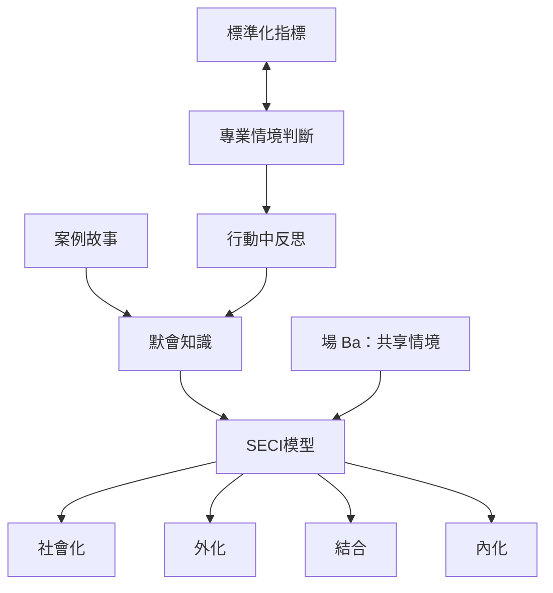

組織可以運用文件、模型與指標促進知識交流，但不能只靠外化把技能從人身上抽離。SECI 模型、案例故事、專業判斷與行動中反思共同揭示，知識創造需要共享情境、信任、回饋與再次實踐。

關聯概念：[[默會知識的哲學基礎與類型]]、[[默會知識的學習、實踐與傳承]]、[[默會知識的治理、權力與公共價值]]。

## 延伸閱讀
* [[SECI模型描述知識互動，但不是默會知識的完整轉換公式]]
* [[量化指標應支持而非取代情境化專業判斷]]
* [[信任與地方脈絡是集體知識運作的基礎]]
* [[以工作故事建立保留脈絡的案例知識庫]]
