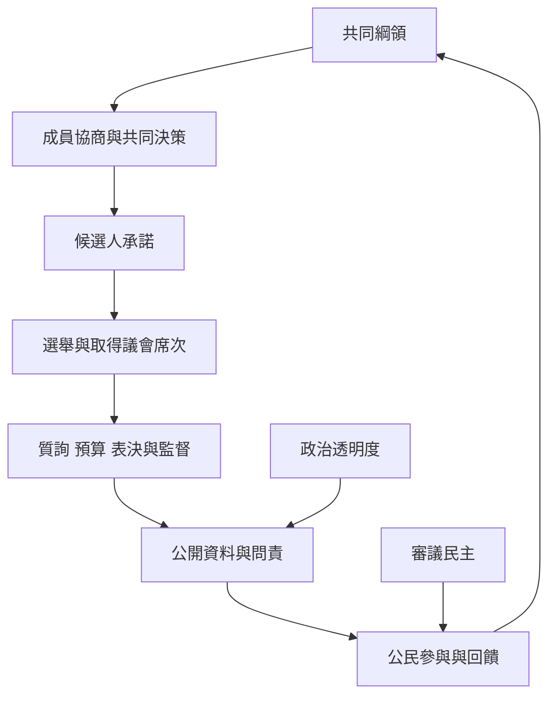

聯盟能否把共同價值轉成可信的治理能力，取決於內部協商、公開透明、候選人問責與公民參與能否形成循環。共同綱領應同時說明承諾、責任者、資料來源、檢核方式與修正程序。

概念連結：[[term/參與式民主讓受影響者能參與公共決策]]、[[term/審議民主透過公開理由交換改善集體判斷]]、[[term/政治透明度讓公眾能追溯權力與資源如何運作]]、[[term/候選人問責要求承諾與當選後行動可以互相核對]]。

## 思與行
- 將每一項承諾對應至一份可查證資料與一個更新時程。
- 每年公開執行情況與修正理由，讓問責成為持續學習而非單次攻防。

## 參考
- [[data/台灣前進陣線行動綱領與合作協調機制]]。
- [[data/台灣前進陣線候選人資料公開與刑事紀錄圖鑑的使用限制]]。
- [[note/政黨聯盟的民主正當性來自內部治理與外部問責]]。
