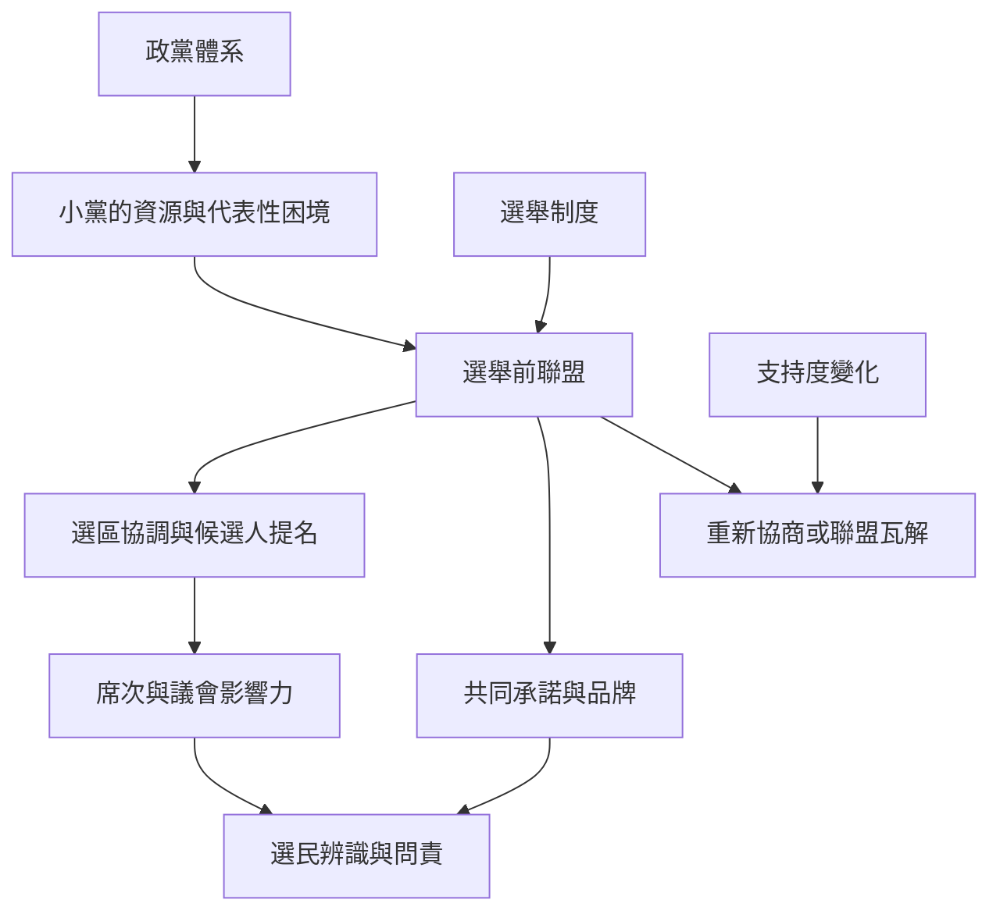

小黨聯盟的形成與成效，取決於政黨體系、選舉規則、彼此相對實力、提名協商與選民問責。這張圖將制度條件與組織策略分開，便於比較芬蘭、印度、紐西蘭、德國與台灣案例。

延伸閱讀：[[term/選舉前聯盟是政黨在投票前建立的合作安排]]、[[term/多席次選區讓同一選區有多名候選人當選]]、[[term/政黨體系由競爭與合作關係共同構成]]、[[term/小黨需要將有限資源轉化為可辨識的公共價值]]。

## 思與行
- 以芬蘭、印度、紐西蘭、德國案例逐一填入制度條件，不把結果脫離背景比較。
- 將台灣地方議會選舉與立法院選制分開分析，避免錯用政黨票門檻。

## 參考
- [[data/芬蘭選舉前聯盟對小黨代表性與席次分配的研究]]。
- [[data/印度選舉聯盟瓦解與夥伴相對實力變化的研究]]。
- [[data/紐西蘭比例代表制與小黨聯盟研究]]。
- [[data/德國小黨在聯合政府形成中的樞紐角色研究]]。
